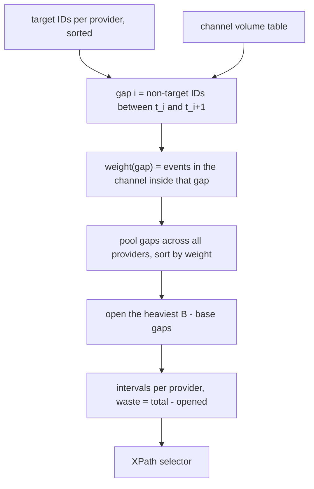
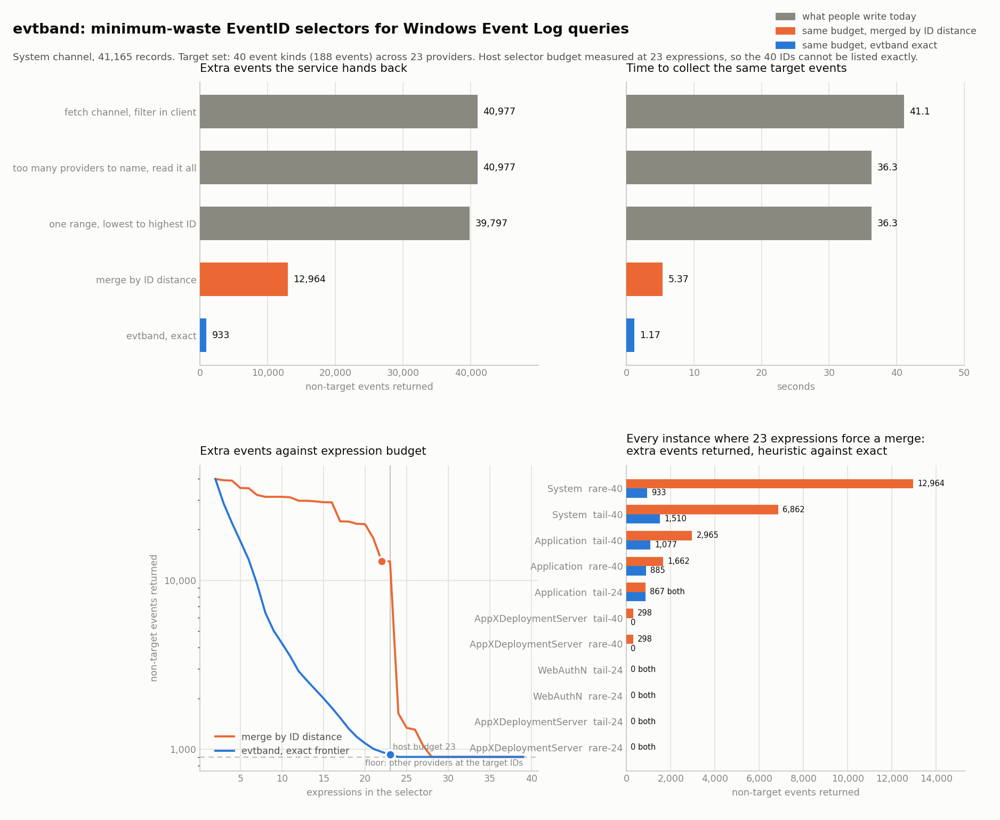

# evtband

Synthesises the provably least wasteful EventID selector for a Windows Event Log
query, for a target event set that is too large to spell out under the host's
expression budget.

## Problem

A Windows Event Log channel has no index on EventID. When you ask for a filtered
set of events, the service walks the channel and hands back everything the
selector matches, and the cost of the query is almost exactly linear in the
number of events it hands back. On this machine's `System` channel, 41,165
records, the same collection costs:

| selector | events returned | wall clock |
|---|---:|---:|
| `*`, every record, filtered in the client | 41,165 | 52.1 s |
| `Provider[@Name='Service Control Manager']` | 3,432 | 1.64 s |
| the same provider and `EventID` in {7000, 7031, 7034} | 138 | 0.17 s |

So the selector is the whole game, and the only thing that matters is how many
non-target events it lets through.

There is a hard limit on how precise a selector can be. A single XPath selector
accepts a bounded number of expressions, and the limit is small. Probing this
host's service directly:

| selector shape | largest accepted |
|---|---:|
| `EventID=a or EventID=b or ...` | 23 terms |
| `(EventID>=a and EventID<=b) or ...` | 22 ranges |
| `Provider[@Name='p'] and (EventID=a or ...)` | 1 provider term plus 22 terms |

Every shape lands on the same arithmetic: one expression per comparison, one per
provider term, and one extra for using any range at all, with a ceiling of 23.
A monitoring rule set that names 40 event IDs therefore cannot be expressed. Some
of those IDs have to be merged into ranges, and the ranges admit events nobody
asked for.

Which merges you pick is where the cost goes, and it is normally decided by
eye. The intuitive choice is to merge the IDs that sit closest together, because
that looks like the smallest widening. Event ID volumes are extremely skewed, so
a two-ID gap can hold ten thousand events while a two-hundred-ID gap holds none.
Merging by ID distance optimises the wrong quantity.

## What it does

`evtband` takes a target set of `(provider, EventID)` pairs, a volume table
measured from the channel itself, and the host's expression budget, and returns
the selector that minimises the number of non-target events the service will
return. The minimum is exact, not approximate, and the planner also emits the
whole cost/waste frontier: for every expression count, the least waste any
selector of that size can achieve.

It also:

- probes the live service to derive the expression budget, rather than trusting
  a documented number;
- builds channel volume tables from `wevtutil`'s raw XML stream, which is about
  two orders of magnitude faster than materialising event objects (41,165
  records in 2.5 s instead of 55 s), and reads only the provider name and the
  event ID, never a message or payload;
- predicts, before the query runs, exactly how many extra events will come back,
  and that prediction is checked against the measured count on every instance in
  the benchmark.

## Why it is interesting

The optimisation looks like it should need a search, and it collapses to a sort.

Let the target IDs of a provider be `t_1 < ... < t_n`, and let gap `g_i` be the
non-target IDs strictly between `t_i` and `t_i+1`, weighted by how many events
the channel actually holds at those IDs. Any selector covering those targets
with `j` intervals is exactly a choice of `j - 1` gaps to leave open, so

```
waste(selector) = sum of all gap weights - sum of the weights of the open gaps
```

and the expression cost is one provider term, one interval, and then exactly one
more expression per open gap. Nothing else in the selector changes either term.
Minimising waste under a budget is therefore maximum-weight subset selection
under a cardinality constraint, pooled across every provider: a uniform matroid,
where taking the heaviest gaps first is optimal. One sort over the gaps produces
not just the optimum for the given budget but the exact frontier for every
budget.

Two consequences that are not obvious before you write it down:

- gaps compete globally. There is no per-provider share of the budget to divide
  up, because an open gap costs one expression wherever it is;
- an EventID-only selector carries a waste floor that no interval choice can
  remove, namely the events other providers emit at the target IDs. The planner
  reports that floor rather than promising zero.

The algorithm is verified against brute force: `tests/test_optimal.py`
enumerates every way to cut every provider's targets into intervals, recounts
the waste straight from the volume table instead of from the gap formula, and
compares the true minimum at every budget against the greedy, in both selector
forms.

## Architecture

FigJam board:
https://www.figma.com/board/E9obpRhGqSIVbadYDb7YOd

The diagram shows the two inputs (the target event set, and the channel volume
table measured from the live log), the host probe that establishes the
expression budget, the gap pooling and weight sort that produce the exact
frontier, and the emitted XPath selector with the validation step that checks
the measured event count against the prediction.



## Results



The metric is the number of **non-target events the service hands back**: events
that match the selector but are not in the target set, and so have to be read,
deserialised, and thrown away by the caller. It is the right metric because the
channel has no EventID index, so the cost of a query is set almost entirely by
how many events come back, and because it is checkable: the planner predicts it
before the query runs, and the benchmark compares the prediction against the
count the service actually returns.

Every number below is measured on this machine's live event logs. In the full
pass, fast selectors are run three times round robin and the fastest run is
kept, while the slow ones, an order of magnitude apart, are run once; the raw
results are committed in `data/bench.json` and reproduced by
`python scripts/bench.py`. The wall clock in the first table comes from a
separate clean re-measurement of those same five selectors, three rounds each,
with nothing else running (`scripts/retime.py`, `data/retime.json`). Event
counts in that re-measurement differed by at most 9 out of 41,165, because the
System channel was written to between the two runs.

### The headline instance

The `System` channel holds 41,165 records. The target set is the 40 rarest event
kinds in it, 188 events in total, emitted by 23 different providers. Those 40
kinds use 39 distinct event IDs, so listing them exactly takes 39 expressions
and the host allows 23. Every selector below has to give something up.

| selector | expressions | extra events returned | wall clock |
|---|---:|---:|---:|
| read the channel, filter in the client | n/a | 40,977 | 41.1 s |
| providers exceed the budget, read it all | n/a | 40,977 | 36.31 s |
| one range, lowest to highest target ID | 2 | 39,797 | 36.27 s |
| merge by ID distance | 22 | 12,964 | 5.37 s |
| evtband, exact | 23 | 933 | 1.17 s |

Reading the channel and filtering in the client, which is what most scripts do,
returns 40,977 events nobody asked for. Collapsing the 40 target IDs into one
range, the cheapest possible selector, returns 39,797: the target IDs are spread
across most of the ID space, so a single range covers nearly the whole channel.
Naming the 23 providers instead does not fit either, because a parenthesised
disjunction of provider terms tops out at 22 on this host, so that selector
degenerates to reading everything.

The two interesting rows are the last two. Both fit inside the same 23
expression budget and both return every target event. Merging the IDs that sit closest
together leaves 12,964 extra events; choosing the merges by how many events live
in each gap leaves 933, which is 31 above the 902 that no EventID-only selector
can avoid, because 902 of the events at those IDs come from providers outside
the target set. That is 13.9 times fewer events for the same budget, and 4.6
times less wall clock.

### Every instance where the budget forces a merge

| instance | target kinds | merge by ID distance | evtband | factor |
|---|---:|---:|---:|---:|
| `System` rare-40 | 40 | 12,964 | 933 | 13.9x |
| `System` tail-40 | 40 | 6,862 | 1,510 | 4.5x |
| `Application` tail-40 | 40 | 2,965 | 1,077 | 2.8x |
| `Application` rare-40 | 40 | 1,662 | 885 | 1.9x |
| `Application` tail-24 | 24 | 867 | 867 | same |
| `AppXDeploymentServer/Operational` rare-40 | 40 | 298 | 0 | all removed |
| `AppXDeploymentServer/Operational` tail-40 | 40 | 298 | 0 | all removed |
| `AppXDeploymentServer/Operational` rare-24 | 24 | 0 | 0 | same |
| `AppXDeploymentServer/Operational` tail-24 | 24 | 0 | 0 | same |
| `WebAuthN/Operational` rare-24 | 24 | 0 | 0 | same |
| `WebAuthN/Operational` tail-24 | 24 | 0 | 0 | same |

Of the 14 target sets measured, 3 were small enough that an exact enumeration of
their distinct IDs fits inside 23 expressions, so nothing has to be merged and
every policy produces the same selector. Those are excluded above. Of the 11
where the budget does bind, evtband is strictly better on 6 and ties on 5. On
four of those six it returns 1.9, 2.8, 4.5 and 13.9 times fewer extra events; on
the other two it removes all 298 of the heuristic's extra events.
Ties are expected: when the heavy gaps happen to also be the wide ones, merging
by ID distance lands on the optimum anyway. The point is that evtband is never
worse, and that it knows when it has reached the floor. On
`AppXDeploymentServer` the two 40 ID target sets coincide, because the channel
has only 60 event kinds and both the rarest 40 and the low volume tail of 40
pick the same set.

### Does the prediction hold

The planner states how many extra events a selector will return before it runs.
Across the 45 measured selectors, 29 matched exactly. The other 16 came back
higher by one event (12 selectors on `Application`) or by six (the four `span`
selectors on `AppXDeploymentServer`). Both channels were written to while the
benchmark was running, which the provider-only baselines show directly: they
returned 25,187 and 6,531 events against the 25,186 and 6,525 records the volume
tables were built from. The six new `AppXDeploymentServer` records land inside
the wide `span` range but outside the narrower intervals the other policies
pick, which is why only `span` sees them. Every selector on `System` and
`WebAuthN`, neither of which grew during its own instances, matched to the
event.

## How to run it

Windows only: it talks to the Windows Event Log service. Python 3.11 or newer.
Reading the channels used here needs no elevation.

```
pip install -r requirements.txt

python scripts/collect_histograms.py          # volume tables, about 20 s
python -m evtband calibrate                   # probe this host's budget
python demo.py                                # plan, then prove it on the log
python tests/test_optimal.py                  # brute force verification
python tests/test_xpath.py                    # selector emission round trip
python scripts/bench.py                       # full measurement, about 40 min
python scripts/make_chart.py                  # writes docs/before_after.png
```

Plan a selector for your own target set:

```
python -m evtband plan --channel System --provider "Service Control Manager" \
    --ids 7000,7001,7022,7023,7024,7026,7031,7034,7036,7040 --run

python -m evtband frontier --channel Application --rare 40
```

`--rare N` takes the N lowest volume event kinds in the channel, which is the
triage shape of the problem. `--run` executes the selector and checks the
measured event count against the prediction. `--qualified` names every provider
in the selector instead of filtering on EventID alone; pass `--budget` with it,
because the service applies its limit per expression chain for that form and the
calibrated flat budget is only a conservative bound there.

To collect volume tables for other channels:

```
python scripts/collect_histograms.py System Application "Microsoft-Windows-Ntfs/Operational"
```

## Scope and honest limits

- The expression budget is calibrated for the **flat, single-chain selector**:
  the form `-FilterXPath`, `wevtutil qe /q:`, the Event Viewer filter, and
  hand-written log shipper configs all use. Measured on this host, a chain takes
  23 operands and a parenthesised group operand costs one extra: 23 bare
  equalities fit, 22 ranges fit, a provider term plus 22 equalities fit, 22
  provider terms in a disjunction fit, and 21 nested provider groups fit. A
  structured query with one `<Select>` element per event ID sidesteps the limit
  entirely (1,000 `<Select>` elements were accepted), so this tool is for the
  single-selector surfaces, not for hand-built structured XML.
- Gap weights come from what the channel holds now. An event ID with no history
  weighs zero, so a selector can widen across it for free and then pick up
  events if that ID starts firing. Recollect the volume tables to re-plan.
- The optimum is over the stated selector family: provider terms conjoined with
  EventID equalities and ranges. A richer grammar, for example qualifying only
  some providers and sharing one unqualified range across the rest, is not
  searched.
- Channel record counts move while the benchmark runs, so a measured waste can
  land a few events away from the prediction on a busy channel. The benchmark
  reports every such difference rather than rounding it away.

## Example outputs

Probing the host for the selector budget. Nothing here is read from
documentation; every number comes from a selector the service accepted or
refused.

```
$ python -m evtband calibrate
flat selector budget on this host: 23 expressions
  largest accepted, bare equalities        23
  largest accepted, ranges                 22
  largest accepted, provider plus equality 22

  a provider term costs 1, an equality costs 1, a range costs 1,
  and using any range at all costs 1 more
```

The planner on the `System` channel with the 40 rarest event kinds as the
target set. The frontier gives the exact minimum extra events for every
expression count, so it also says what one more expression would buy: at 24 it
reaches the 902 floor that no EventID-only selector can beat, and the host
allows 23.

```
$ python demo.py System 40
host selector budget
------------------------------------------------------------------------
calibrated on System: equalities=23 ranges=22 provider+equalities=22 range_surcharge=1

instance
------------------------------------------------------------------------
System: 40 target kinds across 23 providers, 188 target events of 41165 in channel
an exact enumeration needs 39 expressions, the host allows 23

exact cost and waste frontier (minimum extra events per expression)
------------------------------------------------------------------------
 expressions  terms  extra events
           2      1         39797
           3      2         28464
           4      3         21837
         ...
          22     21           965
          23     22           933  <- budget
          24     23           902
          25     24           902
          26     25           902
          30     29           902
          36     35           902

policies at 23 expressions, predicted then measured
------------------------------------------------------------------------
policy    cost  predicted  measured  match       ms
span         2      39797     39806  off 9    40594
width       22      12964     12972  off 8     5262
evtband     23        933       933    yes     1159
postfilter    -      40977     40986  off 9    42329

selector
------------------------------------------------------------------------
*[System[((EventID>=3 and EventID<=5) or (EventID>=24 and EventID<=26) or EventID=35 or EventID=41 or EventID=62 or (EventID>=101 and EventID<=102) or EventID=134 or (EventID>=161 and EventID<=162) or EventID=187 or (EventID>=247 and EventID<=263) or EventID=1001 or (EventID>=1031 and EventID<=1040) or EventID=1073 or (EventID>=4107 and EventID<=5001) or EventID=5006 or EventID=6008 or EventID=6166 or EventID=7011 or EventID=7023 or (EventID>=10000 and EventID<=10002) or EventID=10100 or (EventID>=24576 and EventID<=24579))]]
```

The `off` entries are the channel moving under the measurement, not a modelling
error. `System` took 9 new records between the volume table and this run. Eight
of them fall inside the ranges the ID-distance merge picked, all nine fall
inside the single wide `span` range and inside the client-side filter, and none
fall inside the exact selector, which is narrow enough to miss them, so its
prediction is still correct to the event. Rerun
`python scripts/collect_histograms.py` to re-plan against the current channel.
